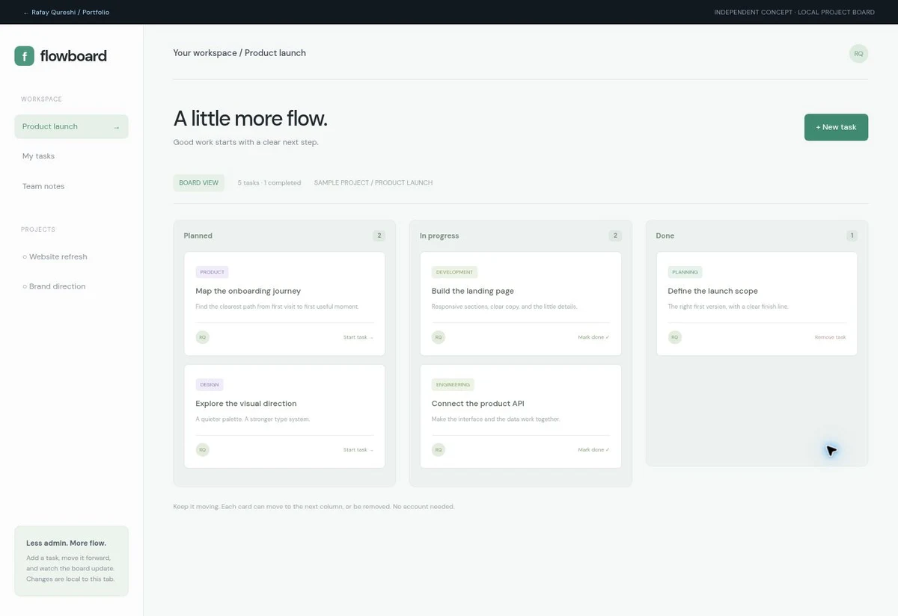

# Flowboard — Project Workspace

A browser-local Kanban workspace for moving a project from planned to done.



## Explore

- Create tasks with a title, notes and status
- Move tasks into progress and done
- Remove completed sample tasks
- Update column counts and completion totals

## Run locally

```bash
python -m http.server 8000
```

Open http://localhost:8000. No build step, account, API key or package installation is required.

## Stack

HTML, CSS and JavaScript. Google Fonts have system-font fallbacks.

## Scope

Original frontend concept by Muhammad Rafay Qureshi, prepared in November 2026. Tasks are kept in memory in the current tab and reset on reload. No personal data is sent to a server. The included shared demo assets power the interactions selected by this page's `data-demo` attribute.

## Portfolio

[View the portfolio source](https://github.com/rafayyqureshi/rafay-portfolio) · [GitHub profile](https://github.com/rafayyqureshi)
